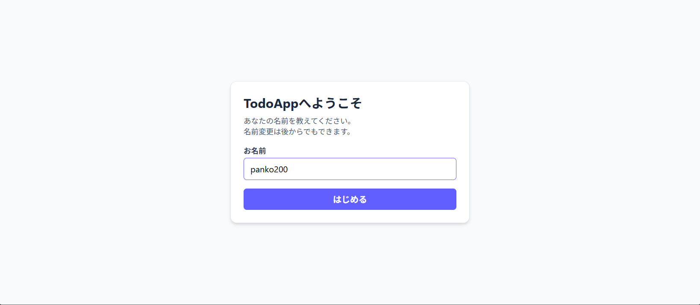
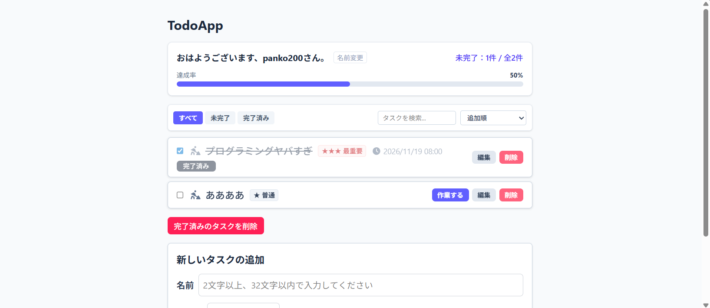
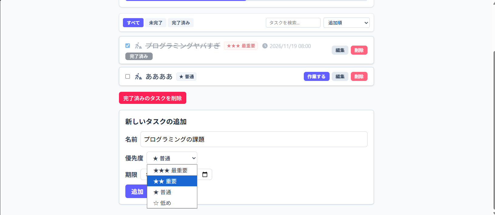
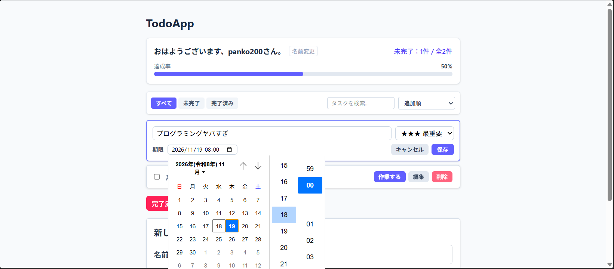
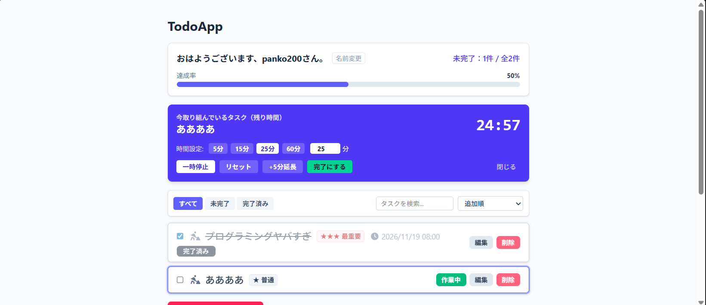

# TodoApp

---

# はじめに

YMM4関連のリポジトリではありません。  
これは学校用兼Todoアプリのリポジトリであり、YMM4とは何も関連していません。  

---

## 公開 URL

**[TodoApp](https://panko200.github.io/TodoApp_React/)**

---

# アプリの概要

React、TypeScript、Tailwind CSS を使用し、ローカルストレージでデータを永続化した「Todoアプリ」です。  

---

## アプリの機能

初めに、このTodoアプリにアクセスすると、ユーザー名登録をする画面になります。これによって、好きなユーザー名でTodoアプリを使用することができるようになります。  
また、ユーザー名はローカルストレージで保存され、次以降はその画面はスキップされるようになります。また、TodoAppの画面にて、名前変更を押すと、いつでも名前を変更できます。
また、本機能では、Todoを追加することはもちろん、Todoをソートしたり、未完了のもの、完了済みのもののみを表示するように設定できるようにしています。  
そして、登録されているTodoの個数と完了した個数の比率をゲージで表示する機能も有しています。  
また、登録されたTodoを編集することができるようになっており、また、「作業する」を押せばタイマーを使うことができます。

## 開発背景

ユーザー名登録は、元々のチュートリアル時に存在したものが変更できないということに不満を持ち、webアプリ側から自分で変えられるようにしたほうが面白いのではないか？と考え名前を変更できるようにしました。そして、そうなればローカルストレージから名前が既に存在しているかを確認して、もし存在していたら登録画面をスキップするようにしたらより良いのではと思ってそのような機能を追加しました。  

そして、ソート機能は、Todoアプリとして不可欠かなと思ったために作りました。期限順とかに並べられないとわかりづらいことがあると思ったためです。  

また、これは地味な変更ですが、チュートリアルで使われていた重要度の1,2,3にて、どっちが重要でどっちが軽視していいものなのかがわからなかったため、選択ボックスを用意して、日本語ラベルとして、「最重要、重要、普通、低め」としておくことによって、日本語としてはわかりやすいUIになったと思っています。  

そして、登録されているTodoの個数と完了した個数の比率をゲージで表示する機能に関しては、追加してみたいなとは思ったものの、作り方がわからなかったため、AIに作ってもらいました。完了済みのものはどうせ削除するのであまり有用な機能ではありませんが、やってみたかった。といったところです。  

また、既に登録されているTodoを編集できるようにしたのは、一度登録したもので、提出期限の変更などがあった際、いったん削除して再度登録をするというその工程が面倒くさいと感じたからです。  

そして、最後に、「作業する」というボタンを押せばタイマーが使えるという点ですが、これは私が以前に購入した作業用ゲーム、「Chill with You : Lo-Fi Story」にて存在した機能を作ったほうが面白いのでは？と思って作成した機能です。  
とは言え、これを作成するにあたってもあまり作り方がわからなかったため、AIを使用しました。しかし、そのままの状態だと、UIや機能が気にいらないものが多かったため、その部分は自分で修正しました。  
例えば、タイマー部分だけ青色にしたり、Rounded-fullからRounded-mdに変更したり。本当はスマホのタイマーのように、タイマー周りに円状の進行度ゲージを追加したかったものの、これまた作り方がわからなかったため、そちらの機能は断念しました。

## 使用時の画面

---

---

---

---

## 使用技術

使用した技術は、TypeScript、Reactで、UIのデザインはTailwind CSSを使用しました。  
また、ユーザー名やTodoデータの保存などは、ローカルストレージを使用しています。

## 開発履歴

- 2026年10月23日：プロジェクト開始
開発期間: 2026.10.23 ~ 2026.11.18 (約19時間)

## ライセンス

[MIT License](/LICENSE)